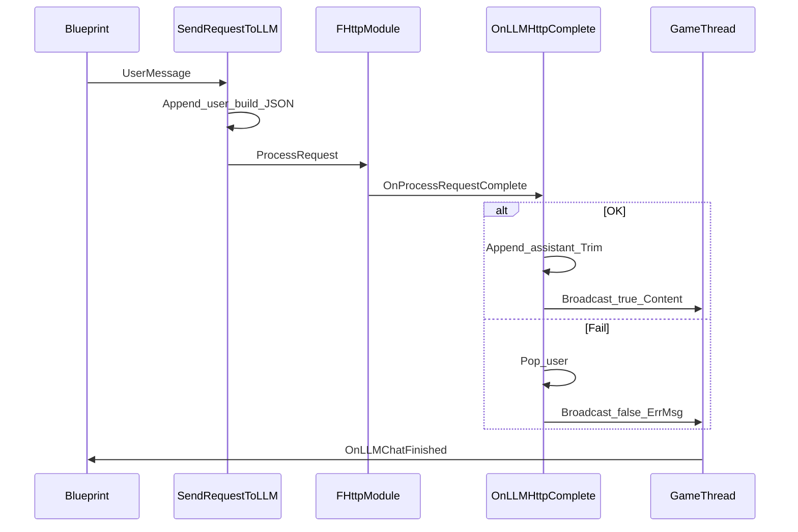

# AIBrainComponent 逐行说明（面向不熟悉 UE C++ 的读者）

本文对应工程中的：

- [Source/SmartNPC/Public/AIBrainComponent.h](../Source/SmartNPC/Public/AIBrainComponent.h)
- [Source/SmartNPC/Private/AIBrainComponent.cpp](../Source/SmartNPC/Private/AIBrainComponent.cpp)

先读下面一小节 **UE C++ 常见概念**，再对照头文件与实现文件，会容易很多。

---

## 一、先搞懂的 UE C++ 概念（很短）

| 概念 | 含义 |
|------|------|
| **UObject** | 能被 UE 反射系统管理的对象基类，支持编辑器、GC（垃圾回收）、蓝图等。 |
| **Actor** | 世界里的「实体」，可放置、可移动；**Component** 挂在 Actor 上提供能力（如你的 AI 大脑）。 |
| **`UCLASS` / `USTRUCT`** | 宏：告诉 **UHT（Unreal Header Tool）** 生成反射代码，这样蓝图才能看到类/结构体。 |
| **`GENERATED_BODY()`** | 放在 `UCLASS` / `USTRUCT` 里，由 UHT 生成内部样板代码，**必须写且只能写一处**。 |
| **`UPROPERTY`** | 成员变量可被 UE 序列化、在编辑器 **Details** 里显示、或暴露给蓝图读写。 |
| **`UFUNCTION`** | 成员函数可被蓝图调用（如 `BlueprintCallable`）或成为蓝图事件。 |
| **`FString`** | UE 的字符串类型；字面量用 **`TEXT("...")`** 包起来，以支持宽字符与跨平台。 |
| **`int32`** | UE 常用的 32 位整数类型名（比写 `int` 更明确）。 |
| **`TArray<T>`** | UE 的动态数组，类似 `std::vector`。 |
| **`TSharedPtr` / `TSharedRef`** | 智能指针，共享所有权；UE 的 HTTP 请求常用 `TSharedRef<IHttpRequest>`。 |
| **`Super::`** | 调用父类同一名字的虚函数（例如 `Super::BeginPlay()`），避免漏掉引擎逻辑。 |
| **`SMARTNPC_API`** | 模块导出宏：本 DLL 里的类给别的模块用时需要正确导出（由 `SMARTNPC` 模块名生成）。 |

---

## 二、`AIBrainComponent.h` 逐段说明

### 第 1 行

```cpp
// Fill out your copyright notice in the Description page of Project Settings.
```

**普通注释**：模板提示，无运行作用。

---

### 第 3 行：`#pragma once`

**标准 C++ 头文件守卫**：保证同一个 `.cpp` 多次 `#include` 该头时，**只展开一次**，避免重复定义类。

---

### 第 5–8 行：包含头文件

```cpp
#include "CoreMinimal.h"
```

UE 最常用的基础类型与宏（如 `UCLASS`、`FString` 等）的聚合入口。

```cpp
#include "Components/ActorComponent.h"
```

**`UActorComponent`** 的声明：你的 `UAIBrainComponent` 继承它，才能作为组件挂在 Actor 上。

```cpp
#include "Interfaces/IHttpRequest.h"
#include "Interfaces/IHttpResponse.h"
```

HTTP **请求/响应接口**类型；后面回调里会用到 `FHttpRequestPtr`、`FHttpResponsePtr`（多为 `TSharedPtr` 的别名）。

```cpp
#include "AIBrainComponent.generated.h"
```

**必须在 `.h` 最后 `#include` 之一，且在所有 `UCLASS`/`USTRUCT`/`UPROPERTY`/`UFUNCTION` 相关宏之前**（UE 规则）。  
UHT 会生成 `AIBrainComponent.generated.h`，里面是反射、序列化等生成的代码。**不要手写该文件。**

---

### 第 11 行：动态多播委托（蓝图可绑）

```cpp
DECLARE_DYNAMIC_MULTICAST_DELEGATE_TwoParams(FOnLLMChatFinished, bool, bSuccess, FString, Message);
```

- **委托（Delegate）**：一种「回调列表」：某件事发生时 **Broadcast**，所有绑定过的函数都会执行。
- **Dynamic**：蓝图可以 `Bind` / 在 Details 里 **+** 事件。
- **Multicast**：允许多个监听者。
- **TwoParams**：两个参数——`bool bSuccess`、`FString Message`。
- **`FOnLLMChatFinished`**：委托的 **类型名**；下面成员 `OnLLMChatFinished` 就是该类型的一个变量。

---

### 第 13–23 行：单条聊天消息结构体

```cpp
USTRUCT(BlueprintType)
struct FLLMChatMessage
```

- **`USTRUCT`**：可被反射的结构体；**`BlueprintType`**：蓝图里可以当变量类型用（例如以后扩展）。

```cpp
{
	GENERATED_BODY()
```

`USTRUCT` 里同样需要 **`GENERATED_BODY()`**，由 UHT 生成内部代码。

```cpp
	UPROPERTY(EditAnywhere, BlueprintReadWrite, Category = "AI_System")
	FString Role;
```

- **`EditAnywhere`**：在编辑器里实例上可改（不限于默认值）。
- **`BlueprintReadWrite`**：蓝图可读可写。
- **`Category`**：在 Details 面板里的分组路径。
- **`Role`**：OpenAI 风格里的 `"user"` 或 `"assistant"`。

```cpp
	UPROPERTY(EditAnywhere, BlueprintReadWrite, Category = "AI_System")
	FString Content;
```

本条消息的文本内容。

---

### 第 25–28 行：组件类声明

```cpp
UCLASS(ClassGroup = (Custom), meta = (BlueprintSpawnableComponent))
class SMARTNPC_API UAIBrainComponent : public UActorComponent
```

- **`UCLASS`**：反射类；**`ClassGroup`**：在编辑器 Add Component 菜单里的分组名。
- **`BlueprintSpawnableComponent`**：允许在蓝图编辑器里 **Add Component** 添加该类。
- **`SMARTNPC_API`**：DLL 导出。
- **`U` 前缀**：UE 约定，**`UObject` 派生类**以 `U` 开头（如 `UAIBrainComponent`）。
- **`public UActorComponent`**：继承引擎的 Actor 组件基类。

```cpp
{
	GENERATED_BODY()
```

`UCLASS` 内 **`GENERATED_BODY()`**（与 `USTRUCT` 同理，但生成内容不同）。

---

### 第 30–31 行：构造函数

```cpp
public:
	UAIBrainComponent();
```

在 **`.cpp`** 里实现：设置 **Tick** 等默认值。

---

### 第 33–34 行：NPC 名字（示例用）

```cpp
	UPROPERTY(EditAnywhere, BlueprintReadWrite, Category = "AI_System")
	FString NPC_Name = TEXT("NPC_01");
```

`TestAILogic` 会用到；与 LLM 无强绑定，属于演示/扩展字段。

---

### 第 36–48 行：LLM 相关配置

```cpp
	/** DashScope OpenAI-compatible base URL (no trailing /chat/completions). */
	UPROPERTY(EditAnywhere, BlueprintReadWrite, Category = "AI_System|LLM")
	FString LLM_BaseUrl = TEXT("https://dashscope.aliyuncs.com/compatible-mode/v1");
```

**文档注释 `/** */`**：会在某些 IDE 里悬浮提示。  
**`AI_System|LLM`**：Details 里二级分类（竖线分层）。  
Base URL **不含** `/chat/completions`，拼接在 `.cpp` 里完成。

```cpp
	UPROPERTY(EditAnywhere, BlueprintReadWrite, Category = "AI_System|LLM")
	FString LLM_API_Key;
```

API Key；**默认空**，需在编辑器里填，勿提交仓库。

```cpp
	UPROPERTY(EditAnywhere, BlueprintReadWrite, Category = "AI_System|LLM")
	FString LLM_Model = TEXT("qwen-plus");
```

请求体里的 **`model`** 字段。

```cpp
	/** Max completed user+assistant turns kept after each reply (matches Python MAX_TURNS). */
	UPROPERTY(EditAnywhere, BlueprintReadWrite, Category = "AI_System|LLM", meta = (ClampMin = "1"))
	int32 MaxTurns = 8;
```

**`meta = (ClampMin = "1")`**：编辑器里最小值钳制为 1。  
语义：每次成功回复后，最多保留最近 **`MaxTurns` 轮** 的 **user+assistant**（每轮 2 条，共 `MaxTurns * 2` 条）。

---

### 第 50–51 行：蓝图事件

```cpp
	UPROPERTY(BlueprintAssignable, Category = "AI_System|LLM")
	FOnLLMChatFinished OnLLMChatFinished;
```

- **`BlueprintAssignable`**：蓝图里可以把「自定义事件」绑到这个委托上（你看到的 **On LLM Chat Finished**）。
- 请求结束后在 C++ 里 **`Broadcast`**。

---

### 第 53–61 行：蓝图可调函数

```cpp
	UFUNCTION(BlueprintCallable, Category = "AI_System")
	void TestAILogic();
```

屏幕打印测试，与 LLM 无关。

```cpp
	UFUNCTION(BlueprintCallable, Category = "AI_System|LLM")
	void SendRequestToLLM(const FString& UserMessage);
```

**对外主入口**：传入用户一句话，内部组 JSON、发 HTTP。

```cpp
	UFUNCTION(BlueprintCallable, Category = "AI_System|LLM")
	void ClearLLMConversation();
```

清空内存中的多轮 **`ConversationMessages`**。

---

### 第 63–68 行：生命周期与 Tick

```cpp
protected:
	virtual void BeginPlay() override;
```

Actor **开始游戏**时调用一次；`override` 表示覆盖父类虚函数。

```cpp
	virtual void EndPlay(const EEndPlayReason::Type EndPlayReason) override;
```

Actor/组件 **结束**（销毁、换关卡等）时调用；这里用来 **取消未完成的 HTTP**。

```cpp
public:
	virtual void TickComponent(float DeltaTime, ELevelTick TickType, FActorComponentTickFunction* ThisTickFunction) override;
```

**每帧**调用（若 Tick 开启）；当前实现里只转调父类，预留扩展。

---

### 第 70–77 行：仅 C++ 可见的成员

```cpp
private:
	void OnLLMHttpComplete(FHttpRequestPtr Request, FHttpResponsePtr Response, bool bConnectedSuccessfully);
```

HTTP 完成回调；**不是 `UFUNCTION`**，蓝图不能直接绑；由 **`BindUObject`** 绑定。

```cpp
	void TrimRecentTurns();
```

裁剪 **`ConversationMessages`** 长度。

```cpp
	void BroadcastOnGameThread(bool bSuccess, const FString& Message);
```

把结果 **派发到游戏线程** 再 **`Broadcast`** 委托（HTTP 回调可能不在游戏线程）。

```cpp
	TArray<FLLMChatMessage> ConversationMessages;
```

多轮对话历史（顺序：user、assistant、user、assistant…）。

```cpp
	TSharedPtr<IHttpRequest> PendingLLMRequest;
```

当前进行中的请求句柄；**`EndPlay`** 时用来取消。

```cpp
	bool bLLMRequestInFlight = false;
```

防止 **重入**（上一次没完又发一次）。

---

## 三、`AIBrainComponent.cpp` 逐段说明

### 第 2–9 行：包含实现所需头文件

```cpp
#include "AIBrainComponent.h"
```

对应自己的声明。

```cpp
#include "HttpModule.h"
```

**`FHttpModule::Get()`**、**`CreateRequest()`**。

```cpp
#include "Dom/JsonObject.h"
#include "Dom/JsonValue.h"
```

构建/解析 JSON；**`FJsonValueObject`** 在 **`JsonValue.h`** 里（不要把不存在的 `JsonValueObject.h` 再 include 进来）。

```cpp
#include "Serialization/JsonReader.h"
#include "Serialization/JsonSerializer.h"
#include "Serialization/JsonWriter.h"
```

**序列化**请求体、**反序列化**响应字符串。

```cpp
#include "Async/Async.h"
```

**`AsyncTask`**：把代码投递到指定线程（这里用 **游戏线程**）。

---

### 第 11–27 行：匿名命名空间（文件内私有函数）

```cpp
namespace
{
```

**匿名 `namespace`**：里面的函数 **`NormalizeBaseUrl` / `BuildChatCompletionsUrl`** 只在当前 `.cpp` 内可见，**不污染全局符号**，也不进头文件。

```cpp
FString NormalizeBaseUrl(const FString& InUrl)
{
	FString Url = InUrl.TrimStartAndEnd();
```

去掉首尾空格/换行。

```cpp
	while (Url.Len() > 0 && Url.EndsWith(TEXT("/")))
	{
		Url.LeftChopInline(1, EAllowShrinking::No);
	}
```

若末尾有多余 **`/`**，循环删掉，避免后面拼 **`/chat/completions`** 时出现 **`//`**。  
**`EAllowShrinking::No`**：不收缩 `TArray` 底层缓冲区（UE 新 API，替代已弃用的 `bool`）。

```cpp
	return Url;
}
```

```cpp
FString BuildChatCompletionsUrl(const FString& BaseUrl)
{
	return NormalizeBaseUrl(BaseUrl) + TEXT("/chat/completions");
}
```

拼出 OpenAI 兼容的聊天接口完整路径。

```cpp
}
```

结束匿名命名空间。

---

### 第 29–32 行：构造函数

```cpp
UAIBrainComponent::UAIBrainComponent()
{
	PrimaryComponentTick.bCanEverTick = true;
}
```

**`PrimaryComponentTick.bCanEverTick`**：允许组件 **Tick**；若永远不用 `TickComponent` 逻辑，可改为 `false` 省性能。

---

### 第 34–42 行：`BeginPlay`

```cpp
void UAIBrainComponent::BeginPlay()
{
	Super::BeginPlay();
```

先执行父类逻辑（引擎依赖）。

```cpp
	if (GEngine)
	{
		GEngine->AddOnScreenDebugMessage(-1, 10.f, FColor::Red, TEXT("C++ Activating!"));
	}
```

**`GEngine`**：非 PIE 或某些上下文可能为空，故判断。  
**`-1`**：键值，同一键会覆盖上一条；**`10.f`**：显示秒数。

```cpp
}
```

---

### 第 44–55 行：`EndPlay`

```cpp
void UAIBrainComponent::EndPlay(const EEndPlayReason::Type EndPlayReason)
{
	if (PendingLLMRequest.IsValid())
	{
```

还有未完成请求时。

```cpp
		PendingLLMRequest->OnProcessRequestComplete().Unbind();
```

解绑回调，避免对象销毁后仍被调用。

```cpp
		PendingLLMRequest->CancelRequest();
```

尽量取消网络层请求。

```cpp
		PendingLLMRequest.Reset();
```

释放 **`TSharedPtr`** 引用。

```cpp
	}
	bLLMRequestInFlight = false;

	Super::EndPlay(EndPlayReason);
}
```

最后调用父类 **EndPlay**。

---

### 第 57–60 行：`TickComponent`

```cpp
void UAIBrainComponent::TickComponent(float DeltaTime, ELevelTick TickType, FActorComponentTickFunction* ThisTickFunction)
{
	Super::TickComponent(DeltaTime, TickType, ThisTickFunction);
}
```

**`DeltaTime`**：上一帧到这一帧的秒数。当前无每帧逻辑，仅占位。

---

### 第 62–68 行：`TestAILogic`

```cpp
void UAIBrainComponent::TestAILogic()
{
	if (GEngine)
	{
		GEngine->AddOnScreenDebugMessage(-1, 5.f, FColor::Cyan, FString::Printf(TEXT("NPC %s is thinking..."), *NPC_Name));
	}
}
```

**`FString::Printf`**：格式化字符串；**`*NPC_Name`**：把 `FString` 转成 **`const TCHAR*`** 给 `%s` 用（UE 里常见写法）。

---

### 第 70–73 行：`ClearLLMConversation`

```cpp
void UAIBrainComponent::ClearLLMConversation()
{
	ConversationMessages.Reset();
}
```

**`Reset()`**：清空数组并释放元素。

---

### 第 75–84 行：`TrimRecentTurns`

```cpp
void UAIBrainComponent::TrimRecentTurns()
{
	const int32 MaxMessages = MaxTurns * 2;
```

只保留最近 **`MaxTurns`** 个来回，每来回 2 条消息。

```cpp
	if (ConversationMessages.Num() <= MaxMessages)
	{
		return;
	}
```

已够短则不动。

```cpp
	const int32 RemoveCount = ConversationMessages.Num() - MaxMessages;
	ConversationMessages.RemoveAt(0, RemoveCount);
}
```

从 **头部** 删掉多余条数，等价 Python 的 **`messages[-max_messages:]`**。

---

### 第 86–98 行：`BroadcastOnGameThread`

```cpp
void UAIBrainComponent::BroadcastOnGameThread(bool bSuccess, const FString& Message)
{
	TWeakObjectPtr<UAIBrainComponent> WeakThis(this);
```

**弱引用**：异步 lambda 里若组件已销毁，**`IsValid()` 为 false**，避免访问悬空 **`this`**。

```cpp
	AsyncTask(ENamedThreads::GameThread, [WeakThis, bSuccess, Message]()
	{
```

把工作丢到 **游戏线程** 队列；**按值捕获** `bSuccess`、`Message`（复制 `FString`），避免悬空。

```cpp
		if (!WeakThis.IsValid())
		{
			return;
		}
		UAIBrainComponent* Self = WeakThis.Get();
		Self->OnLLMChatFinished.Broadcast(bSuccess, Message);
	});
}
```

在 **游戏线程** 上 **`Broadcast`**，蓝图里改 UI 更安全。

---

### 第 100–166 行：`SendRequestToLLM`（主流程）

```cpp
void UAIBrainComponent::SendRequestToLLM(const FString& UserMessage)
{
	const FString Trimmed = UserMessage.TrimStartAndEnd();
	if (Trimmed.IsEmpty())
	{
		BroadcastOnGameThread(false, TEXT("Input cannot be empty."));
		return;
	}
```

空输入直接失败提示；**不修改**历史。

```cpp
	if (LLM_API_Key.TrimStartAndEnd().IsEmpty())
	{
		BroadcastOnGameThread(false, TEXT("LLM_API_Key is not set."));
		return;
	}
```

无 Key 无法鉴权。

```cpp
	if (bLLMRequestInFlight)
	{
		BroadcastOnGameThread(false, TEXT("A request is already in progress."));
		return;
	}
```

防止并发两次请求导致状态错乱。

```cpp
	ConversationMessages.Add(FLLMChatMessage{TEXT("user"), Trimmed});
```

先把本轮 **user** 写入历史（与 Python 一致）；若后面失败会 **pop** 掉。

```cpp
	TSharedPtr<FJsonObject> Root = MakeShared<FJsonObject>();
	Root->SetStringField(TEXT("model"), LLM_Model);
	Root->SetBoolField(TEXT("stream"), false);
```

根 JSON：`model`、**非流式**（一次收完整 JSON，便于用 `FJsonSerializer` 解析）。

```cpp
	TArray<TSharedPtr<FJsonValue>> MsgArray;
	MsgArray.Reserve(ConversationMessages.Num());
	for (const FLLMChatMessage& M : ConversationMessages)
	{
		TSharedPtr<FJsonObject> MsgObj = MakeShared<FJsonObject>();
		MsgObj->SetStringField(TEXT("role"), M.Role);
		MsgObj->SetStringField(TEXT("content"), M.Content);
		MsgArray.Add(MakeShared<FJsonValueObject>(MsgObj));
	}
	Root->SetArrayField(TEXT("messages"), MsgArray);
```

把 **`ConversationMessages`** 编成 **`messages` 数组**；每个元素是 JSON 对象，需包成 **`FJsonValueObject`** 才能放进 **`TArray<TSharedPtr<FJsonValue>>`**。

```cpp
	FString Body;
	const TSharedRef<TJsonWriter<>> Writer = TJsonWriterFactory<>::Create(&Body);
	if (!FJsonSerializer::Serialize(Root.ToSharedRef(), Writer))
	{
		ConversationMessages.Pop(EAllowShrinking::No);
		BroadcastOnGameThread(false, TEXT("Failed to serialize request JSON."));
		return;
	}
```

序列化失败则 **撤回刚加的 user**。

```cpp
	FHttpModule& HttpModule = FHttpModule::Get();
	if (!HttpModule.IsHttpEnabled())
	{
		ConversationMessages.Pop(EAllowShrinking::No);
		BroadcastOnGameThread(false, TEXT("HTTP is disabled in project settings."));
		return;
	}
```

UE 5.6 已无 **`SetHttpEnabled`**；若工程禁了 HTTP，只能提示并撤回 user。

```cpp
	TSharedRef<IHttpRequest> Req = HttpModule.CreateRequest();
	PendingLLMRequest = Req;
```

保存请求指针供 **EndPlay** 取消。

```cpp
	Req->SetVerb(TEXT("POST"));
	Req->SetURL(BuildChatCompletionsUrl(LLM_BaseUrl));
	Req->SetHeader(TEXT("Content-Type"), TEXT("application/json"));
	Req->SetHeader(TEXT("Authorization"), FString::Printf(TEXT("Bearer %s"), *LLM_API_Key.TrimStartAndEnd()));
	Req->SetContentAsString(Body);
```

标准 REST：**POST**、JSON、**Bearer** 鉴权。

```cpp
	Req->OnProcessRequestComplete().BindUObject(this, &UAIBrainComponent::OnLLMHttpComplete);
```

请求完成时调用 **`OnLLMHttpComplete`**；**`BindUObject`** 会在 **`this`** 销毁时自动解绑（仍建议在 **EndPlay** 里显式处理）。

```cpp
	bLLMRequestInFlight = true;
	Req->ProcessRequest();
}
```

标记进行中并真正发出网络请求。

---

### 第 168–272 行：`OnLLMHttpComplete`（回调）

```cpp
void UAIBrainComponent::OnLLMHttpComplete(FHttpRequestPtr Request, FHttpResponsePtr Response, bool bConnectedSuccessfully)
{
	PendingLLMRequest.Reset();
	bLLMRequestInFlight = false;
```

无论成败，先清「进行中」状态。

```cpp
	auto PopLastUserIfNeeded = [this]()
	{
		if (ConversationMessages.Num() > 0 && ConversationMessages.Last().Role == TEXT("user"))
		{
			ConversationMessages.Pop(EAllowShrinking::No);
		}
	};
```

**Lambda**：捕获 **`this`**，用于失败时与 Python 一样 **撤回本轮 user**；仅当最后一条是 **user** 才 pop（防御）。

```cpp
	if (!bConnectedSuccessfully || !Response.IsValid())
	{
		PopLastUserIfNeeded();
		BroadcastOnGameThread(false, TEXT("Network error or invalid response."));
		return;
	}
```

底层连接失败或无响应对象。

```cpp
	const int32 Code = Response->GetResponseCode();
	const FString Raw = Response->GetContentAsString();
```

**HTTP 状态码**与 **原始响应体**（字符串）。

```cpp
	if (Code < 200 || Code >= 300)
	{
		PopLastUserIfNeeded();

		FString ErrMsg = FString::Printf(TEXT("HTTP %d"), Code);
```

非 2xx：先撤回 user，默认错误信息为 **`HTTP xxx`**。

```cpp
		TSharedPtr<FJsonObject> JsonParsed;
		const TSharedRef<TJsonReader<>> Reader = TJsonReaderFactory<>::Create(Raw);
		if (FJsonSerializer::Deserialize(Reader, JsonParsed) && JsonParsed.IsValid())
		{
			const TSharedPtr<FJsonObject>* ErrObj = nullptr;
			if (JsonParsed->TryGetObjectField(TEXT("error"), ErrObj) && ErrObj && (*ErrObj).IsValid())
			{
				FString ApiMsg;
				if ((*ErrObj)->TryGetStringField(TEXT("message"), ApiMsg))
				{
					ErrMsg = ApiMsg;
				}
			}
		}
```

尝试解析 OpenAI 风格 **`error.message`**。

```cpp
		else if (Raw.Len() > 0 && Raw.Len() < 512)
		{
			ErrMsg = Raw;
		}

		BroadcastOnGameThread(false, ErrMsg);
		return;
	}
```

若不是 JSON，且正文很短，直接把原文当错误信息（调试用）。

---

以下分支：**HTTP 2xx**，但还要检查 JSON 结构。

```cpp
	TSharedPtr<FJsonObject> JsonParsed;
	const TSharedRef<TJsonReader<>> Reader = TJsonReaderFactory<>::Create(Raw);
	if (!FJsonSerializer::Deserialize(Reader, JsonParsed) || !JsonParsed.IsValid())
	{
		PopLastUserIfNeeded();
		BroadcastOnGameThread(false, TEXT("Failed to parse response JSON."));
		return;
	}
```

```cpp
	const TArray<TSharedPtr<FJsonValue>>* Choices = nullptr;
	if (!JsonParsed->TryGetArrayField(TEXT("choices"), Choices) || !Choices || Choices->Num() == 0)
	{
		PopLastUserIfNeeded();
		BroadcastOnGameThread(false, TEXT("Response has no choices."));
		return;
	}
```

```cpp
	const TSharedPtr<FJsonObject> Choice0 = (*Choices)[0]->AsObject();
	if (!Choice0.IsValid())
	{
		PopLastUserIfNeeded();
		BroadcastOnGameThread(false, TEXT("choices[0] is invalid."));
		return;
	}
```

```cpp
	const TSharedPtr<FJsonObject>* MessagePtr = nullptr;
	if (!Choice0->TryGetObjectField(TEXT("message"), MessagePtr) || !MessagePtr || !(*MessagePtr).IsValid())
	{
		PopLastUserIfNeeded();
		BroadcastOnGameThread(false, TEXT("Response has no message."));
		return;
	}
```

```cpp
	FString Content;
	if (!(*MessagePtr)->TryGetStringField(TEXT("content"), Content))
	{
		PopLastUserIfNeeded();
		BroadcastOnGameThread(false, TEXT("Response has no content."));
		return;
	}
```

以上逐级取 **`choices[0].message.content`**；任一步失败都 **pop user** 并广播错误。

```cpp
	Content.TrimStartAndEndInline();
	if (Content.IsEmpty())
	{
		PopLastUserIfNeeded();
		BroadcastOnGameThread(false, TEXT("Model returned empty text."));
		return;
	}
```

去掉空白后仍为空，视为失败（与「无有效回复」一致）。

```cpp
	ConversationMessages.Add(FLLMChatMessage{TEXT("assistant"), Content});
	TrimRecentTurns();

	BroadcastOnGameThread(true, Content);
}
```

成功：写入 **assistant**、裁剪历史、**`bSuccess = true`** 广播 **`Content`**。

---

## 四、整体流程（简图）



---

## 五、和蓝图怎么对应

| C++ | 蓝图里常见名字 |
|-----|----------------|
| `OnLLMChatFinished` | **On LLM Chat Finished** |
| `SendRequestToLLM` | **Send Request to LLM** |
| `ClearLLMConversation` | **Clear LLM Conversation** |
| `bSuccess` / `Message` 委托参数 | **Success** / **Message** 引脚 |

---

## 六、延伸阅读（官方与习惯）

- **Actor 与组件**：在 UE 文档中搜索 *Actor Lifecycle*、*Components*。
- **HTTP**：`*HTTP` 模块、`IHttpRequest`。
- **JSON**：`*Json` 模块、`FJsonObject`、`FJsonSerializer`。

若你希望把某一段改成「流式输出」或加 **system** 提示词，可以在不改蓝图引脚的前提下，只改 `.cpp` 里组 JSON 与解析部分（需另开设计）。

---

*文档生成自当前仓库中的 `AIBrainComponent.h` / `AIBrainComponent.cpp`，若源码有改动，请以源码为准并同步更新本文。*
